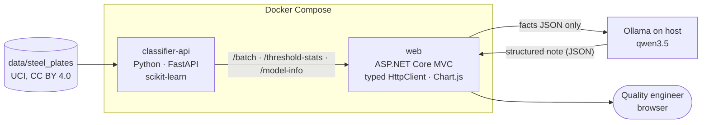
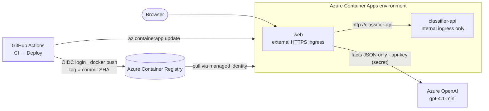

# Steel Defect Triage Copilot

[](https://github.com/chris-loog/steel-defect-triage/actions/workflows/ci.yml)
[](https://github.com/chris-loog/steel-defect-triage/actions/workflows/deploy.yml)


An automatic surface-inspection system finds defects on steel plates. This app classifies each defect into one of
7 fault types, lets a quality engineer pick a confidence threshold that splits a batch into **auto-classified** and
**manual review**, and has an LLM write a short handover note about the batch. It's a small end-to-end Data & AI
project: a Python classifier, an ASP.NET Core web app and an LLM (local Ollama, or Azure OpenAI when deployed to
Azure Container Apps).

> [!NOTE]
> **Real data:** [UCI Steel Plates Faults](https://doi.org/10.24432/C5J88N) by M. Buscema, S. Terzi and W. Tastle
> (2010), licensed [CC BY 4.0](https://creativecommons.org/licenses/by/4.0/). It contains 1,941 defects with 27
> geometric and luminosity features. See [`data/steel_plates/README.md`](data/steel_plates/README.md).

## What it does
1. **Classifies** each defect (Bumps, Dirtiness, K_Scatch, Other_Faults, Pastry, Stains, Z_Scratch) with a
   scikit-learn GradientBoosting model served by FastAPI. Each prediction comes with a confidence score.
2. **Triages** a batch of 50 defects in an ASP.NET Core MVC page. It shows a fault-mix chart, a confidence dot strip
   and a threshold slider. Moving the slider shows how many defects need manual review and the error rate to expect
   on the auto-classified ones (measured on the held-out test set).
3. **Writes a handover note:** an LLM (local Ollama, or Azure OpenAI in the cloud) turns precomputed facts into a headline and three short sections:
   which defects to review first, what to watch out for (confused fault types, less reliable classes, an unusual
   mix), and what moving the threshold would change.

The demo batches are random samples from the held-out test set (the dataset has no timestamps or production
batches), so the page can also mark wrong predictions.

## Architecture


**The LLM never produces numbers.** C# (`TriageFacts`, `SummaryFacts`) computes everything: fault mix, review queue
with runner-up classes, confusion groups, per-class reliability and the threshold trade-off. The LLM only phrases
those facts, using structured output (JSON schema) for a fixed note format. A `NumberGuard` then flags any number in
the note that isn't in the facts. If the LLM is unavailable, the rest of the page still works.

## Azure deployment


- **Hosting:** two Azure Container Apps in one environment (Sweden Central). Only `web` is public; `classifier-api`
  has internal ingress and is reached by its app name. Both scale to zero when idle, so the first request after a
  pause takes ~20 s (cold start); the classifier HttpClient timeout is 30 s for that reason.
- **LLM in the cloud:** `Llm__Provider=azureopenai` switches `ILlmClient` to `AzureOpenAiLlmClient` (v1 Chat
  Completions API, strict JSON-schema output). Locally the default stays Ollama. The API key exists only as a
  Container App secret (`secretref:`), never in `appsettings.json` or the repository.
- **No stored passwords:** the container apps pull images from the registry with a system-assigned managed identity
  (`AcrPull`); the registry admin user is disabled.
- **Continuous deployment:** [`deploy.yml`](.github/workflows/deploy.yml) runs after CI succeeds on a push to `main`
  (or manually). It logs in to Azure with OpenID Connect: a federated credential trusts GitHub tokens for this
  repository's `main` branch only, and the identity has Contributor on the resource group plus `AcrPush` on the
  registry. It builds both images, tags them with the commit SHA and rolls out a new revision of each app.
- **Costs:** Container Registry Basic (~5 USD/month), Container Apps within the monthly free grant at demo traffic,
  Azure OpenAI pay-per-token, budget alert in Cost Management.

<details>
<summary>One-time setup (Azure CLI)</summary>

```bash
RG=rg-steel-defect-triage; LOC=swedencentral; ACR=<registry>; OAI=<openai-resource>
az group create -n $RG -l $LOC
az acr create -g $RG -n $ACR --sku Basic --admin-enabled false
az cognitiveservices account create -g $RG -n $OAI -l $LOC --kind OpenAI --sku S0 --custom-domain $OAI
az cognitiveservices account deployment create -g $RG -n $OAI --deployment-name gpt-4.1-mini \
  --model-name gpt-4.1-mini --model-version 2025-04-14 --model-format OpenAI --sku-name GlobalStandard --sku-capacity 10
# first images: docker build both Dockerfiles, az acr login -n $ACR, docker push
az containerapp env create -g $RG -n cae-steel-defect-triage -l $LOC
az containerapp create -g $RG -n classifier-api --environment cae-steel-defect-triage --image $ACR.azurecr.io/classifier-api:<tag> \
  --registry-server $ACR.azurecr.io --registry-identity system --ingress internal --target-port 8000 --min-replicas 0 --max-replicas 1
az containerapp create -g $RG -n web --environment cae-steel-defect-triage --image $ACR.azurecr.io/web:<tag> \
  --registry-server $ACR.azurecr.io --registry-identity system --ingress external --target-port 8080 --min-replicas 0 --max-replicas 1 \
  --secrets llm-api-key="$(az cognitiveservices account keys list -g $RG -n $OAI --query key1 -o tsv)" \
  --env-vars ClassifierApi__BaseUrl=http://classifier-api Llm__Provider=azureopenai \
    Llm__AzureOpenAI__Endpoint=https://$OAI.openai.azure.com Llm__AzureOpenAI__ApiKey=secretref:llm-api-key
```

GitHub → Azure login: create an Entra app registration + service principal, add a federated credential (issuer
`https://token.actions.githubusercontent.com`, audience `api://AzureADTokenExchange`), assign Contributor on the
resource group and `AcrPush` on the registry, then set the repository variables `AZURE_CLIENT_ID`, `AZURE_TENANT_ID`,
`AZURE_SUBSCRIPTION_ID`, `ACR_NAME` and `AZURE_RG`. The federated credential subject must match the token exactly;
GitHub now includes immutable owner/repo IDs: `repo:<owner>@<owner-id>/<repo>@<repo-id>:ref:refs/heads/main`
(the exact value is printed in the failed `azure/login` log). Teardown: `az group delete -n $RG` and delete the app
registration.
</details>

## Model
Stratified 80/20 split (seed 42, 389 test defects). Model chosen by 5-fold cross-validated macro F1 on the training set.

| Model (held-out test set) | Accuracy | Macro F1 |
|---|---|---|
| Baseline: most frequent class | 0.347 | 0.074 |
| RandomForest | 0.784 | 0.786 |
| **GradientBoosting (used)** | **0.789** | **0.789** |

- **Leakage check:** the absolute plate-position features (`X/Y_Minimum/Maximum`) added only 0.01–0.03 macro F1,
  only through Y, and with no physical explanation, so they were dropped as likely line-specific. 22 features remain.
- **Hardest classes:** Pastry, Dirtiness and Bumps are often confused with Other_Faults.
- **Threshold trade-off (test set):**

  | Threshold | Auto-classified | Errors among auto-classified |
  |---|---|---|
  | 0.6 | 80 % | 15.2 % |
  | 0.7 | 68 % | 10.9 % |
  | 0.8 | 57 % | 8.2 % |

Exploration: [`classifier/notebooks/02_steel_explore.ipynb`](classifier/notebooks/02_steel_explore.ipynb).

## Tech stack
- **ML service:** Python 3.14, pandas, scikit-learn, FastAPI, Jupyter (exploration)
- **Backend / UI:** ASP.NET Core MVC (.NET 10), typed `HttpClient` via `IHttpClientFactory`, Chart.js
- **LLM:** behind a small `ILlmClient` interface: Ollama locally (no API key, data stays on the machine), Azure
  OpenAI (`gpt-4.1-mini`) in the cloud
- **Ops:** Docker Compose, GitHub Actions (CI + deploy via OIDC), pytest, xUnit
- **Azure:** Container Apps, Container Registry, Azure OpenAI, managed identity, Entra ID federated credentials

## Quick start
Requirements: Docker with Compose, and [Ollama](https://ollama.com) on the host with `ollama pull qwen3.5`.
Containers reach Ollama on the host via `host.docker.internal`, so Ollama must listen on the docker0 IP
(`OLLAMA_HOST=172.17.0.1:11434`).

```bash
docker compose up --build -d
# UI → http://localhost:5088    Python API docs → http://localhost:8000/docs
docker compose down
```

The Python image trains the model at build time. Without Docker: in `classifier/` create a venv, install
`requirements-dev.txt`, run `python train.py` and `uvicorn app:app --port 8000`; then
`dotnet run --project backend/DefectTriage.Web`. Configuration via environment variables: see `.env.example`
(including the Azure OpenAI settings for `Llm__Provider=azureopenai`).

## Tests & CI
```bash
cd classifier && .venv/bin/pytest -q            # features, leakage decision, API contract
dotnet test SteelDefectTriage.slnx -v q          # facts, NumberGuard, prompt, controller (in-memory)
```
The controller tests run the whole web app in memory (`WebApplicationFactory`) with a fake Python API and a fake
LLM. GitHub Actions runs both suites on every pull request and on every push to `main`; a green run on `main`
triggers the Azure deploy. Tests never call the LLM (`AzureOpenAiLlmClient` is tested with a fake HTTP handler).

## Repository layout
```
data/steel_plates/               UCI Steel Plates Faults (unchanged) + attribution README
classifier/                      features.py, train.py, app.py (FastAPI), model/ (metrics, test predictions), tests/, notebooks/
backend/DefectTriage.Web/        ASP.NET Core MVC app: API client, triage/summary facts, LLM client, NumberGuard, UI
backend/DefectTriage.Web.Tests/  xUnit tests
compose.yaml                     runs classifier-api + web
.github/workflows/               ci.yml (tests), deploy.yml (Azure Container Apps)
```

## Limitations & next steps
- One public dataset from one line: the results show the method, not real plant performance.
- No timestamps, so "batches" are samples from the test set rather than real production batches.
- `NumberGuard` catches invented numbers, but not a real number attached to the wrong defect. The note still needs a
  human read.
- Cold start of ~20 s after idle periods (scale to zero keeps the demo nearly free).
- Next: production hardening, e.g. limits on LLM requests for the public deployment.

The first version (hourly output forecast on simulated data) is kept under the git tag `v1`.

## License
Code: [MIT](LICENSE). Data: UCI Steel Plates Faults, CC BY 4.0, Buscema, Terzi & Tastle (2010),
doi:[10.24432/C5J88N](https://doi.org/10.24432/C5J88N).
