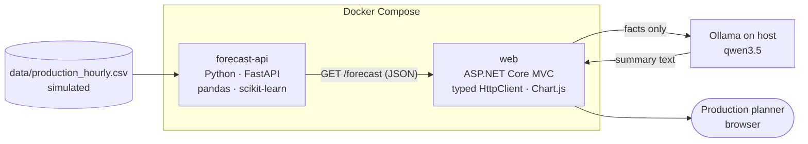

# Production Forecast Copilot

[](https://github.com/chris-loog/production-forecast-copilot/actions/workflows/ci.yml)


> **v2 in progress:** pivoting to steel-plate defect triage on real data (UCI Steel Plates Faults, CC BY 4.0, see
> [`data/steel_plates/README.md`](data/steel_plates/README.md)). The text below describes v1 (git tag `v1`).

Forecasts the next 24 hours of output for a manufacturing line, then has an LLM explain the forecast in
plain language for a production planner. It's a small end-to-end Data & AI project: Python forecasting,
an ASP.NET Core web app and a local LLM.

> [!NOTE]
> **The data is simulated.** No public dataset of real hourly production output exists, so the data comes
> from a small Python "digital twin" of a production line. It models shifts, planned maintenance, random
> breakdowns, product changeovers and scrap. Every chart and API response labels it as simulated.

## What it does
1. **Simulates** two years of hourly output for one production line (3 shifts, seed 42, reproducible).
2. **Forecasts** units produced for each of the next 24 hours with a scikit-learn RandomForest, served by FastAPI.
3. **Shows** the forecast in an ASP.NET Core MVC page: KPI cards, a Chart.js chart against the naive baseline,
   and an hourly table.
4. **Explains** it: a local LLM (Ollama) writes a short summary for the planner covering peak and low hours,
   shift effects, dips and the change from the previous day.

## Architecture


**The LLM never produces numbers.** C# (`ForecastFacts`) computes every fact: peak and low hours, shift
averages, change from yesterday. The LLM only turns those facts into sentences, which keeps the summary
consistent with the chart. If Ollama is down, the rest of the page still works.

## Model
Features: hour of day, day of week, output 24 h ago and output 168 h ago. All of them are known one day
ahead, so a single model predicts each of the next 24 hours directly. Time-based split, with the last
8 weeks held out as the test set.

| Model (test MAE, units/hour) | MAE |
|---|---|
| Baseline: same hour yesterday | 40.6 |
| Baseline: same hour last week | 16.3 |
| **RandomForest (used)** | **10.3** |
| GradientBoosting | 10.5 |

Most of the remaining error comes from random breakdowns, which by design can't be forecast.

## Tech stack
- **Forecasting:** Python 3.14, pandas, scikit-learn, FastAPI, Jupyter (exploration)
- **Backend / UI:** ASP.NET Core MVC (.NET 10), typed `HttpClient` via `IHttpClientFactory`, Chart.js
- **LLM:** Ollama (local, no API key, data stays on the machine) behind a small `ILlmClient` interface
- **Ops:** Docker Compose, GitHub Actions CI, pytest, xUnit

## Quick start
Requirements: Docker with Compose, and [Ollama](https://ollama.com) on the host with `ollama pull qwen3.5`.
Containers reach Ollama on the host via `host.docker.internal`, so Ollama must listen on the docker0 IP
(`OLLAMA_HOST=172.17.0.1:11434`).

```bash
docker compose up --build -d
# UI → http://localhost:5088    Python API docs → http://localhost:8000/docs
docker compose down
```

The Python image trains the model at build time. Without Docker: in `forecasting/` create a venv, install
`requirements-dev.txt`, run `python train.py` and `uvicorn app:app --port 8000`; then
`dotnet run --project backend/ForecastCopilot.Api`.

## Tests & CI
```bash
cd forecasting && .venv/bin/pytest -q             # features + API
dotnet test ProductionForecastCopilot.slnx -v q   # ForecastFacts
```
GitHub Actions runs both on every pull request and on every push to `main`. Tests never call the LLM.

## Repository layout
```
data/                        simulated hourly production CSV (v1), steel_plates/ (v2, real data)
forecasting/                 simulate.py, features.py, train.py, app.py (FastAPI), tests/, notebooks/
backend/ForecastCopilot.Api/ ASP.NET Core MVC app: API client, ForecastFacts, LLM client, Chart.js UI
backend/ForecastCopilot.Api.Tests/  xUnit tests
compose.yaml                 runs forecast-api + web
```

## Limitations & next steps
- The data is simulated and covers a single line, so the results show the method rather than real plant performance.
- Breakdowns can't be forecast. A real system would combine this with MES status data.
- Next: optional Azure deployment.

## License
[MIT](LICENSE)
